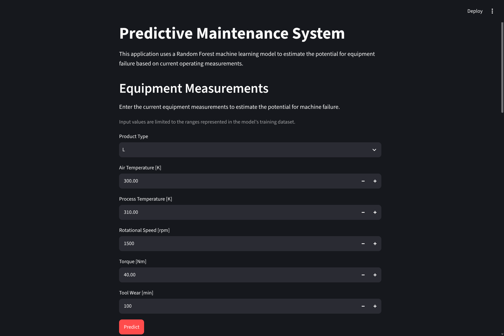
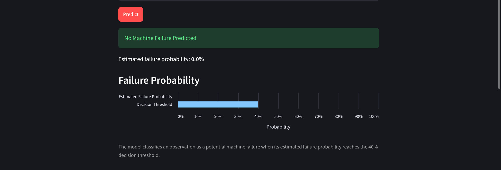
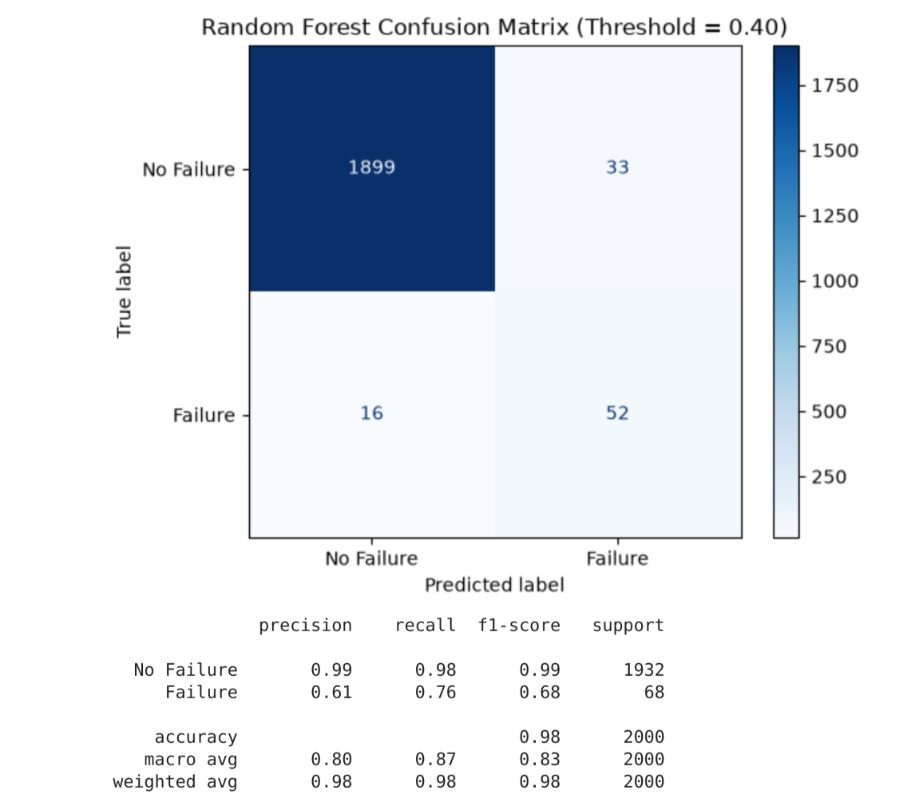
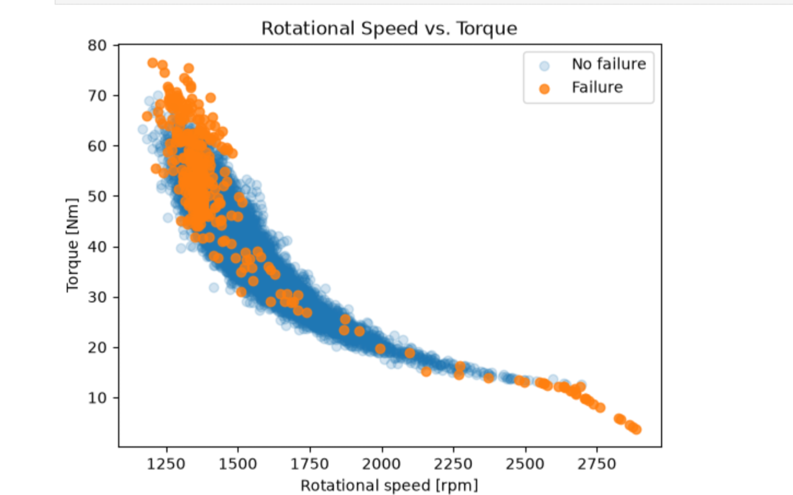

# Predictive Maintenance System

A machine learning application for estimating the likelihood of industrial equipment failure from operating measurements. Built with **Python**, **scikit-learn**, and **Streamlit**, the project combines data exploration, model evaluation, and an interactive interface for testing machine operating conditions.

The application uses the **AI4I 2020 Predictive Maintenance Dataset** and a trained Random Forest classifier. It is a demonstration using synthetic data, not a production-ready equipment monitoring system.


*Interactive Prediction Interface*


*Equipment Failure Prediction Results*

## Features

- **Interactive predictions:** Enter product type, air and process temperatures, rotational speed, torque, and tool wear.
- **Failure probability:** View the model's estimated probability of machine failure and a classification based on a **40% decision threshold**.
- **Visualizations:** Explore dataset characteristics and model results in the Streamlit application.
- **Model information:** Review information about the model and general maintenance practices.

## Model and Evaluation

The final model is a **Random Forest classifier** trained on the AI4I 2020 Predictive Maintenance Dataset, which contains **10,000 observations**. Only **3.39%** of observations represent machine failures, creating a significant class imbalance that must be considered when evaluating model performance.

### Model Selection

Random Forest was selected after evaluating multiple classification approaches. The model provided a useful balance between failure detection and false-positive predictions while accommodating nonlinear relationships between equipment operating characteristics.

### Performance

The final model was evaluated using a **stratified 20% held-out test set**, preserving the original distribution of failure and non-failure observations.

| Metric | Result |
| --- | ---: |
| Precision | 61.2% |
| Recall | 76.5% |
| F1-score | 68.0% |
| ROC-AUC | 0.963 |

On the held-out test set, the model identified **76.5% of actual machine failures**, while **61.2% of observations classified as failures were true failures**. These results illustrate the trade-off between detecting equipment failures and generating false alarms.

Because machine failures are relatively uncommon, precision and recall provide more meaningful measures of performance than classification accuracy alone.

### Classification Threshold

The classification threshold was set to **40% rather than the default 50%** to prioritize identifying potential equipment failures.

Lowering the threshold can improve recall at the expense of additional false-positive predictions, reflecting a trade-off between missed failures and unnecessary maintenance investigations.

The reported precision, recall, and F1-score reflect the final model using this 40% decision threshold.


*Random Forest Confusion Matrix - Held-Out Test Set*

## Technical approach

**Input features.** The model uses six equipment characteristics: product type, air temperature (K), process temperature (K), rotational speed (rpm), torque (Nm), and tool wear (min).

**Avoiding target leakage.** The dataset includes individual failure-mode indicators in addition to the overall machine-failure target. The failure-mode indicators are **not used as predictive features**; predictions use the six equipment characteristics listed above.

**Evaluation under class imbalance.** With only 3.39% failure observations, the evaluation reports precision, recall, F1-score, and ROC-AUC rather than relying solely on classification accuracy.

**Application integration.** A saved model pipeline (`models/random_forest_pipeline.joblib`) is used by the Streamlit application to generate probabilities and classifications from user-provided measurements.


*Exploratory Analysis — Rotational Speed vs. Torque by Failure Status*

## Getting started

### Requirements

- Python 3
- Dependencies listed in `requirements.txt`

### Installation

Clone the repository and enter the project directory:

```bash
git clone https://github.com/dillon-christensen/predictive-maintenance.git
cd predictive-maintenance
```

Create and activate a virtual environment:

```bash
python -m venv .venv
source .venv/bin/activate  # Linux / macOS
```

On Windows, activate it with `.venv\Scripts\activate` instead.

Install dependencies:

```bash
pip install -r requirements.txt
```

### Run the application

From the repository root:

```bash
streamlit run src/app.py
```

Streamlit will provide a local URL to open in your browser.

### Make a prediction

1. Select a product type.
2. Enter air temperature, process temperature, rotational speed, torque, and tool wear.
3. Select **Predict**.
4. Review the estimated failure probability and whether it meets the 40% decision threshold.

The application also provides visualizations of the dataset and model results.

## Project structure

```text
predictive-maintenance/
├── data/
│   └── ai4i2020.csv
├── docs/
│   └── images/
│       ├── app_1.png
│       ├── app_2.png
│       ├── confusion-matrix.png
│       └── data-exploration.png
├── models/
│   └── random_forest_pipeline.joblib
├── notebook/
│   ├── 01_exploratory_data_analysis.ipynb
│   ├── 02_model_proof_of_concept.ipynb
│   ├── 03_finalize_preprocessing.ipynb
│   ├── 04_post_testing.ipynb
│   └── 05_final_testing.ipynb
├── src/
│   └── app.py
├── requirements.txt
└── README.md
```

## Testing

The final model was evaluated against a stratified 20% held-out test set. Application-level checks compared Streamlit predictions against results from the final testing notebook using three observations:

- A known failure observation
- A known non-failure observation
- A failure observation near the 40% decision threshold

For these cases, the Streamlit application returned the same probabilities and classifications as the testing notebook.

## Limitations and future work

The AI4I 2020 dataset is synthetic, so results do not establish performance on real industrial equipment. The application classifies observations from supplied operating measurements; it does not predict how far in advance a failure will occur. A production system would require representative real-world data, time-aware validation, ongoing monitoring, and integration with equipment data sources.

Potential extensions include testing the model on real equipment histories, evaluating threshold trade-offs for different operational costs, and adding continuous sensor-data ingestion.

## Dataset and project background

Data: [AI4I 2020 Predictive Maintenance Dataset — UCI Machine Learning Repository](https://archive.ics.uci.edu/dataset/601/ai4i+2020+predictive+maintenance+dataset). The dataset contains synthetic machine operating measurements, a machine-failure target, and individual failure-mode indicators.

This project was originally developed as the capstone for a **B.S. in Computer Science at Western Governors University**.
